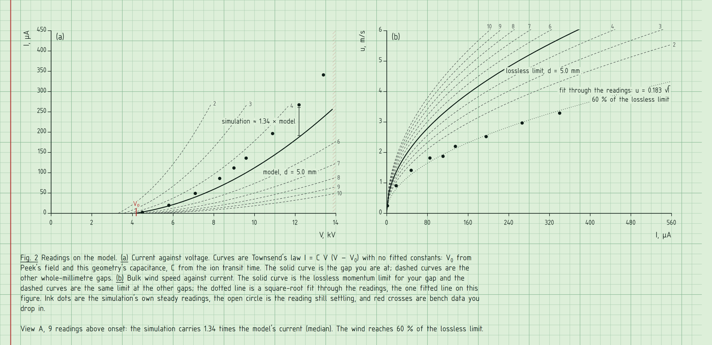

# Drift

**Ionic wind from the field up.** A fan with no moving parts, solved live in your browser: the electric field around a thin wire, the corona ions it sheds once the field crosses Peek's threshold, the push those ions give the air, and the flow that develops from it. Scrub the voltage past onset and watch the current climb and the wind start. Then look at Fig. 2, where the simulation's own readings land as points on the theory's curves.

### [▶ Run it in your browser](https://tringytrongy.github.io/drift/)


No install, no sign-up, no dependencies. It runs on a laptop or a phone.

---

## What you are looking at

The page is one sheet of an engineer's computation pad, and the experiment is running on it. Everything sits on the sheet's own ruling: Fig. 1 is drawn at two squares per millimetre, so the grid is also the scale.

| Part | What it shows | What you can do |
|---|---|---|
| **Fig. 1** | The channel of an ionic fan in section: the emitter wire, the grounded collector (hatched), insulating walls. Ink lines are field lines, which the ions follow. Dashed graphite lines are equipotentials. Red pencil shading is ion space charge. Grey streaks are smoke tracers carried by the air. | **Drag the collector** (or the arrows under the gap dimension) to change the gap. Toggle layers under the caption. |
| **Settings** | Voltage on the wire, the gap, and the collector: **A** twin plates, **B** a bar grid, **C** an airfoil. The voltage scale marks the onset voltage V₀ in red and hatches the zone where a real gap would spark over. | Drag the scales. **Drag** the dotted wire radius and electrode length sideways, or focus them and use the arrow keys. |
| **Readings** | Onset voltage, the wire's surface field, current, power, bulk and peak wind speed, volume flow and simulated air time. Values are **pencil while the solver settles and ink once it is steady.** | **Sweep** steps the voltage up from onset and logs eight readings. **Still air** stops the flow. **Pause**. |
| **Fig. 2** | **(a)** Current against voltage; **(b)** wind speed against current. Curves are the model; ink dots are the simulation's steady readings; red crosses are bench data you drop in. | Watch readings ink in as you explore. |
| **Readings log** | Every steady state you reach, with the ratio of simulated to modelled current. Kept between visits. | **Copy as CSV**, **Clear log**. |
| **Bench data** | Your own measurements on the same axes, with a least-squares Townsend fit. | Drop or paste a CSV (format below). |



## Things to try

1. Drag the voltage below the red V₀ mark. The red sheath on the wire disappears, the current reads zero and the air coasts to rest. Drag it back up and watch the wind start again.
2. Press **Sweep**. Eight readings ink in one by one, and Fig. 2(a) fills along the Townsend curve.
3. Drag the collector closer. Onset drops, current rises fast, and the hatched sparkover zone on the voltage scale moves left to meet you.
4. Switch to collector **B** or **C** and compare where the field lines land.
5. Turn on **speed** to see the jet, and turn off **smoke** to see the field lines on their own.
6. Make the wire thicker (drag the wire radius up). Peek's field drops, but the onset voltage still rises: a fat wire needs more volts to reach even a lower field.

## Bench data

Drop a `.csv` or paste rows. Columns can be named in any order; units in the names are respected (`kV` or `V`, `µA`/`uA` or `mA`):

```csv
V_kV, I_uA, u_ms, d_mm
6.0, 18, 1.1, 5
8.0, 61, 1.9, 5
```

Without a header, columns are read as voltage, current, wind speed, gap. Wind speed and gap are optional. Measured an ionic fan of your own, or a commercial solid-state cooler? This is where it goes. Nothing is uploaded: the file is read in your browser.

## How it works

Everything runs in two Web Workers and a canvas; there are no libraries.

**Field.** Potential and space charge obey Poisson's equation on a 240 × 120 grid of 0.1 mm cells, solved by conjugate gradients with a multigrid preconditioner. The potential is split into a unit Laplace solution and a space-charge part,

```math
\varphi = \varphi_e\,L + P,\qquad \nabla^2 L = 0,\qquad \nabla^2 P = -\rho/\varepsilon_0 .
```

**A wire thinner than a cell.** A 25 µm wire is a quarter of a cell, so it lives inside one. That cell's value is the potential at Peaceman's equivalent radius $r_0 = e^{-\pi/2}h$, and the log profile between $r_0$ and the real surface gives the wire's true line charge and surface field without resolving it.

**Corona.** Peek's law gives the field at which air at the wire's surface ionises,

```math
E_p = 3.1\ \text{MV/m}\,\left(1 + \frac{0.0308}{\sqrt{r_w}}\right)\quad (r_w \text{ in metres}).
```

Above it, Kaptzov's hypothesis holds the surface field at $E_p$: the wire sheds exactly the current that keeps it there. Drift solves for that current directly. For a fixed field the swept charge is proportional to the injected current, and by Green's reciprocity the charge it induces on the grounded wire is

```math
\lambda_P = -\sum_k \rho_k\,L_k\,h^2 ,
```

so one sweep at unit current tells the solver the current that pins the surface field.

**Ions.** Positive ions drift at $\mu E$ with $\mu = 2.0\times10^{-4}\ \text{m}^2/(\text{V s})$, hundreds of times faster than the wind, so the wind's effect on them is ignored. Because they only ever move downhill in potential, one sweep through the cells in order of falling $\varphi$ solves the steady upwind charge balance exactly.

**Air.** Incompressible Navier–Stokes on a 0.2 mm staggered grid, semi-Lagrangian advection, explicit viscosity, pushed by the body force $\rho\mathbf{E}$. Air enters from a still room at zero total pressure and leaves at zero static pressure.

### Fig. 2's model

Townsend's law with no fitted constants:

```math
I' = C\,V\,(V - V_0),\qquad V_0 = \frac{2\pi\varepsilon_0 r_w E_p}{C'},\qquad C = \frac{\mu C'}{\ell^2}.
```

$C'$ is the wire's capacitance per metre in this geometry (from the Laplace solve) and $\ell$ is the shortest ion path. The coefficient is a transit-time estimate: above onset the space charge must carry the excess charge $C'(V-V_0)$, and it crosses $\ell$ in about $\ell^2/(\mu V)$. The wind curve is the lossless momentum limit, $u = \sqrt{2I'\ell/(\rho\,\mu\,w)}$ for a channel of height $w$.

How close is it? Current per centimetre of wire, simulation against model:

| View | Gap | V₀ | Just above onset | At twice onset |
|---|---|---|---|---|
| A, twin plates | 3 mm | 3.61 kV | 6.0 vs 5.9 µA/cm (1.01) | 40.3 vs 29.8 (1.35) |
| A, twin plates | 5 mm | 4.20 kV | 3.5 vs 3.4 (1.02) | 22.2 vs 16.9 (1.31) |
| A, twin plates | 8 mm | 5.07 kV | 1.9 vs 1.8 (1.07) | 11.7 vs 8.9 (1.32) |
| B, bar grid | 5 mm | 3.92 kV | 4.3 vs 3.9 (1.12) | 28.7 vs 19.5 (1.47) |
| C, airfoil | 5 mm | 4.48 kV | 2.7 vs 4.3 (0.62) | 19.5 vs 22.8 (0.85) |

A back-of-the-envelope law with no fitted constants lands within about ±40 % of the coupled 2-D solution, and gets the onset exactly (both use the same field solve). The simulated wind reaches about 60 % of the lossless limit; the rest goes to the collector's drag, wall friction and mixing in the jet.

## Limits

It is a two-dimensional section, so currents are per metre of wire and scaled by the electrode length you set. One ion species, no diffusion, no heating, a smooth clean wire, dry air at 1 atm. The sparkover zone is a rough guide (mean field of about 2.5 kV/mm along the shortest path), not a breakdown model; past it the solver keeps going because it does not model streamers. Smoke tracers play back at 1/150 of real speed so you can follow them.

Ventiva's ionic cooling engines are one commercial example of this idea. Drift is not affiliated with Ventiva and contains no Ventiva data: every point in Fig. 2 comes from the solver or from a file you load.

## Running it locally

ES modules and workers need `http://`, so serve the folder rather than opening the file:

```bash
node tools/serve.mjs
```

Then open <http://localhost:5180>. Tests (solver, model and CSV reader) run on Node 20 or newer:

```bash
npm test
```

`node tools/capture.mjs` regenerates the screenshots in `media/` with a headless Chrome or Edge.

```
index.html         the sheet
styles.css         ruling, lettering and controls
src/solver.js      field, corona, ion sweep and air
src/poisson.js     multigrid-preconditioned conjugate gradients
src/geometry.js    channel, wire and the three collectors
src/model.js       Peek, Townsend, momentum limit, fits
src/render.js      Fig. 1
src/plots.js       Fig. 2
src/sim-worker.js  runs the solver off the main thread
src/model-worker.js builds the model curves for every gap
```

## Credits

F. W. Peek, *Dielectric Phenomena in High-Voltage Engineering* (1929), for the onset field. J. S. Townsend (1914) for the current law. N. A. Kaptzov (1947) for the corona boundary condition. D. W. Peaceman (1978) for the equivalent radius that lets a sub-cell wire carry its true charge.

Lettering in [osifont](https://github.com/hikikomori82/osifont), an ISO 3098 engineering face (LGPL-3.0 with font exception). Print in [Barlow Semi Condensed](https://github.com/jpt/barlow) (SIL Open Font License). Drift is a sibling of [Tropism](https://github.com/TringyTrongy/tropism).

## License

[CC BY-NC-SA 4.0](LICENSE). The bundled fonts keep their own licences.
